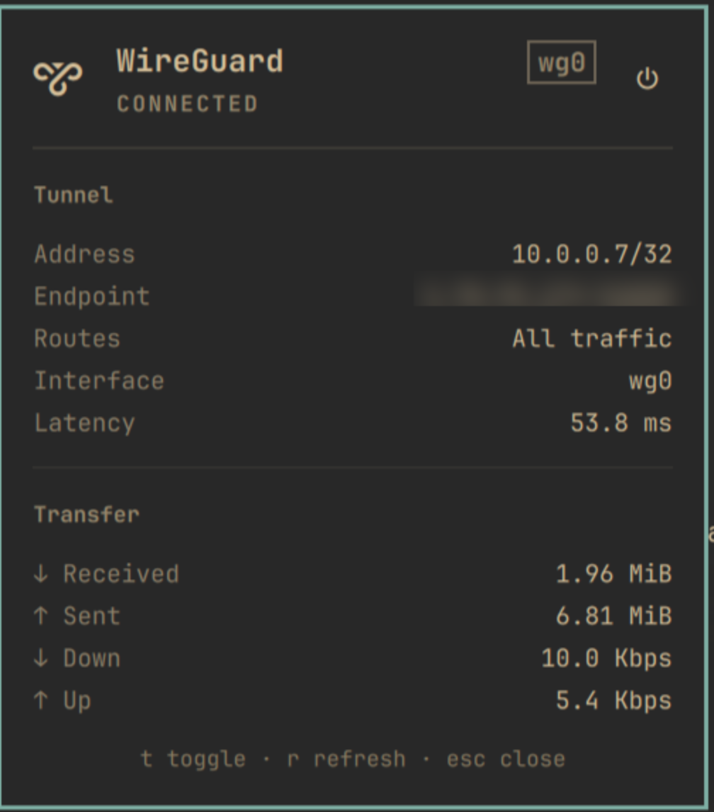

# WireGuard for the Omarchy bar

A WireGuard tunnel in your [Omarchy](https://omarchy.org) status bar: one click
to connect, and a panel that tells you where the traffic is actually going.



Other VPN widgets tell you a tunnel is up. This one tells you what it is doing —
address, endpoint, routing, round-trip latency, total transfer, and live
throughput — using only information a normal user can read.

## Install

```bash
omarchy plugin add https://github.com/DukeRupert/omarchy-wireguard.git --enable
```

Requires Omarchy 4 (Quattro) or later, for the Quickshell plugin host.

## Using it

| | |
|---|---|
| **Left click** | open the panel |
| **Right click** | connect or disconnect |
| **Middle click** | force a refresh |
| **In the panel** | `t` toggle · `s` switch profile · `r` refresh · `esc` close |

The icon is dimmed while the tunnel is down. Hovering names the connection and
its state.

State changes arrive as they happen over `nmcli monitor`, so the icon is right
the moment a tunnel moves — including when something other than this widget
moved it. Nothing is remembered between clicks; the answer always comes from
NetworkManager. Reboot, suspend, or an `nmcli` in a terminal cannot desynchronise
the display.

## Setting up a tunnel

With no WireGuard connection configured, the panel offers an **Import a config…**
button. It opens a terminal and walks you through picking a `.conf` — from a
commercial provider or your own server — then imports it into NetworkManager.

Along the way it refuses a file with no `[Peer]` section (that is a server
config, not a client one) and warns you about any `wg-quick`-only directives
NetworkManager will quietly ignore. Authenticate at the polkit prompt when it
appears. The widget picks the tunnel up immediately, with no configuration.

By hand, the same thing is:

```bash
nmcli connection import type wireguard file ~/Downloads/tunnel.conf
nmcli connection modify tunnel connection.autoconnect no
```

## Why NetworkManager

The tunnel has to be a NetworkManager profile, not a `wg-quick` interface.

That is not incidental. A bar widget has no terminal, so `sudo wg-quick up wg0`
has nowhere to prompt for a password. Activating a NetworkManager system
connection, by contrast, is already permitted for local session users — so
toggling needs no `sudo`, raises no polkit prompt, and stays instant.

The cost is that NetworkManager does not honour `wg-quick`-only directives:
`PostUp`, `PostDown`, `PreUp`, `PreDown`, `Table`, and `SaveConfig`. Most client
configs use none of them. If yours does, reproduce them as NetworkManager
properties (`ipv4.dns`, `ipv4.never-default`, dispatcher scripts) before
switching. The import flow tells you when this applies to your file.

## Full and split modes

Two NetworkManager profiles with the same interface name — a full tunnel and a
split one, say — are treated as two modes of one tunnel. Only one can be up at a
time, so the widget follows whichever is active, and the panel shows a ⇄ button
(`s`) that switches to the next one. NetworkManager takes the current profile
down by itself, so the switch is one step. `connectionName` picks the mode a
plain connect brings up.

```bash
nmcli connection clone wg0 wg0-split
nmcli connection modify wg0-split \
  wireguard.peers "<pubkey> allowed-ips=10.0.0.0/24 endpoint=vpn.example.com:51820" \
  wireguard.ip4-auto-default-route 0 wireguard.ip6-auto-default-route 0
```

## Settings

| Key | Default | Meaning |
|---|---|---|
| `connectionName` | *(empty)* | NetworkManager profile name, per `nmcli connection show`. Empty adopts whichever WireGuard connection exists — set it only if you have more than one. |
| `refreshIntervalSec` | `30` | Fallback poll, and the throughput sampling rate while the panel is open. |
| `pingTarget` | *(empty)* | Address pinged for latency while the panel is open, usually the server's VPN address (e.g. `10.0.0.1`). Empty hides the Latency row. |

Several tunnels can each have their own icon — the widget allows multiple
instances, each with its own `connectionName`.

## Keybindings

The widget registers an IPC target, so any action can go on a Hyprland bind:

```bash
omarchy-shell wireguard toggle       # connect or disconnect
omarchy-shell wireguard connect
omarchy-shell wireguard disconnect
omarchy-shell wireguard swap         # switch to the next profile on this interface
omarchy-shell wireguard status       # prints the current state
omarchy-shell wireguard panel        # open or close the panel
omarchy-shell wireguard refresh
```

Note that `toggle` acts on the *tunnel*, not the panel — unlike most Omarchy
plugins, where `toggle` opens a popup. Connecting is the action worth binding to
a key here, so it gets the short name; the panel is on `panel`.

## What it does not do

- **No handshake ages or per-peer transfer.** Those come from `wg show`, which
  requires root. Everything displayed here is readable as a normal user:
  `nmcli` for state and peer configuration, `/sys/class/net/<dev>/statistics`
  for counters.
- **No `wg-quick` support.** See [Why NetworkManager](#why-networkmanager).
- **No server provisioning.** It manages tunnels; it does not create them.

Multi-peer tunnels get a Peers section listing each peer. IPv4-only, IPv6-only,
and dual-stack configurations each show the addresses they actually have, and a
peer advertising `0.0.0.0/0` **or** `::/0` counts as a full tunnel.

## Development

Parsing lives in `Model.js`, free of QML dependencies, so it can be exercised
without a running shell:

```bash
node tests/model-test.js
```

The suite covers multi-peer meshes, IPv6-only tunnels, split routing, absent
profiles, link-local filtering, and nmcli's terse-output escaping.

Validate the manifest and lint the QML before publishing:

```bash
omarchy plugin validate .
qmllint -I "$OMARCHY_PATH/shell" BarWidget.qml
```

`qmllint` reports `Unexpected token 'void'` for the typed IPC handler functions.
That is qmllint not understanding Quickshell's IPC syntax; the shell parses it
correctly. First-party plugins use the same form.

Changing the root element type is not picked up by the plugin hot-reloader —
run `omarchy restart shell` after that particular kind of edit.

## License

MIT — see [LICENSE](LICENSE).
